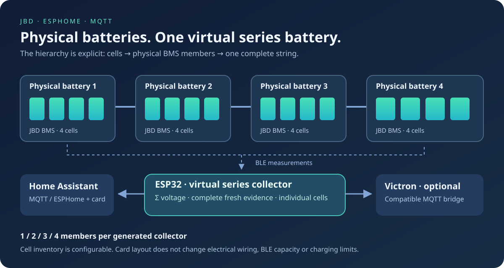
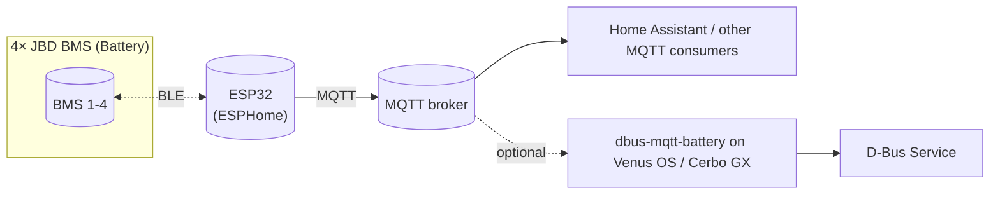

# ESPHome JBD BMS Monitor

[](https://github.com/victron-venus/esphome-jbd-bms-mqtt/actions/workflows/fuzz-candidate.yml)

[](https://www.bestpractices.dev/projects/15572)

[](https://github.com/victron-venus/esphome-jbd-bms-mqtt/actions/workflows/ci.yml)
[](https://opensource.org/licenses/MIT)
[](https://github.com/victron-venus/esphome-jbd-bms-mqtt/releases)
[](https://github.com/victron-venus/esphome-jbd-bms-mqtt/releases)
[](https://esphome.io/)
[](https://www.espressif.com/en/products/socs/esp32)
[](https://github.com/victron-venus/esphome-jbd-bms-mqtt/watchers)
[](https://github.com/victron-venus/esphome-jbd-bms-mqtt/graphs/contributors)
[](https://github.com/victron-venus/esphome-jbd-bms-mqtt/issues)
[](https://github.com/victron-venus/esphome-jbd-bms-mqtt/issues?q=is%3Aissue+is%3Aclosed)
[](https://github.com/victron-venus/esphome-jbd-bms-mqtt/pulls)
[](https://github.com/victron-venus/esphome-jbd-bms-mqtt/commits/main)
[](https://github.com/victron-venus/esphome-jbd-bms-mqtt)
[](https://github.com/victron-venus/esphome-jbd-bms-mqtt)
[](https://github.com/victron-venus/esphome-jbd-bms-mqtt/graphs/commit-activity)
[](https://github.com/victron-venus/esphome-jbd-bms-mqtt/pulls)
[](https://esphome.io/)
[](https://community.victronenergy.com/)

ESP32-based Bluetooth monitor for JBD BMS batteries, publishing measurements via
MQTT to Home Assistant, other MQTT consumers, or Victron Venus OS.

Each collector represents **one virtual battery made from physical batteries in
series**, with individual cells inside each physical battery. Our installed
strings contain four physical batteries each; new private configurations can
represent one, two, three or four members with explicit cell inventories.
See [virtual series batteries: configuration, diagrams, policies and runbook](docs/virtual-series-battery.md).



## Install from your browser

Use **[ESPHome Web](https://web.esphome.io/)** with a factory image built by
ESPHome Device Builder on Home Assistant or another server. No Python,
Homebrew or PlatformIO is needed on the USB-connected computer.
[Follow the browser installation guide](docs/browser-install.md) to configure
your own batteries and credentials, build once, and flash over USB. The current
profiles require a personalised image; CI test firmware is not a public installer.

The two current chain monitors also publish [atomic battery telemetry](docs/battery-telemetry.md)
with boot identity, freshness and complete-round readiness for startup and MQTT reconnects.

> **Victron is optional.** Use an ordinary MQTT broker and Home Assistant without
> a Cerbo GX, Venus OS, or Victron inverter. The
> [dbus-mqtt-battery](https://github.com/victron-venus/dbus-mqtt-battery) bridge is
> required only for integration into Victron. See
> [Using without Victron or Cerbo GX](#using-without-victron-or-cerbo-gx).

<!-- ci-release-process:start -->
## CI and deployment

See [CI and deployment workflow](docs/release-workflow.md) for required checks and local commands. This repository uses validation-only policy; application release channels do not apply.
<!-- ci-release-process:end -->

## Overview

This project reads JBD (Jiabaida) BMS-equipped LiFePO4 batteries over BLE and
exposes their measurements independently of the inverter or monitoring system.
It originated as a Victron integration: direct Bluetooth communication from a
Raspberry Pi/Cerbo GX to JBD BMS proved unreliable and caused system instability
(reboots due to memory leaks in the BLE stack).

### Architecture



### Why ESP32?

- **Dedicated BLE processing**: Offloads Bluetooth Low Energy communication from the main system
- **Reliable connections**: ESP32's BLE stack handles multiple simultaneous connections well
- **Low latency**: Direct BLE-to-MQTT bridge with minimal overhead
- **OTA updates**: Update firmware wirelessly without physical access

## Using without Victron or Cerbo GX

**No Victron equipment is needed to monitor the batteries.** The standalone data
path is **JBD BMS → BLE → ESP32 → Wi-Fi → MQTT broker → Home Assistant**. The
broker can run on Home Assistant OS, a NAS, a Raspberry Pi, or another host; it
does not need to run on a Cerbo. MQTT subscribers other than Home Assistant can
also read the same measurements. Do not install `dbus-mqtt-battery` for this setup.

1. Start with `jbd-all-batteries1.yaml` and the matching local header/package.
   This maintained profile expects **four BMS, with four cells per BMS**. Use the
   second profile for another four batteries. For one, two, three or a different
   cell inventory, use the [private series configuration generator](docs/virtual-series-battery.md#generate-a-private-configuration).
   Non-four-cell generated profiles require the documented schema-2/HA route.
2. Set your BMS addresses in `ble_client`, configure private Wi-Fi/API credentials,
   and point `mqtt.broker` at your own broker. Add broker authentication in the
   private configuration. Keep `battery` for Chain 1 and `battery2` for Chain 2.
3. Add Home Assistant's **MQTT integration** using the same broker. ESPHome's MQTT
   discovery exposes per-battery voltage, current, power, SOC, temperature,
   remaining capacity, cycle count, four individual cell voltages, and status
   entities. Inspect the actual entity IDs in Home Assistant before building cards.
4. Alternatively, connect Home Assistant's **ESPHome integration** to the monitor's
   encrypted native API. Keep `api.reboot_timeout: 0s` when using MQTT without an
   API client; it is already set in both maintained profiles. The firmware still
   uses MQTT for its atomic telemetry, even when HA reads sensors through the API.

The templates preserve existing discovery identities: Chain 1 uses `legacy` and
Chain 2 uses `mac`. For a new installation use `mac` on every monitor; for an
existing installation preserve its IDs and history. A green MQTT connection is
not proof of fresh BMS data, and retained individual sensor values can be old.
For freshness-sensitive consumers, use the non-retained `battery/telemetry` and
`battery2/telemetry` snapshots and their readiness/age fields.

Follow the [standalone Home Assistant guide](docs/standalone-home-assistant.md)
for broker settings, discovery, cell mapping, API usage, and freshness checks.
For a reusable battery and individual-cell display, see the companion
[ha-jbd-bms-card](https://github.com/ha-homelab/ha-jbd-bms-card) Lovelace card.
Map its battery and cell fields to your actual Home Assistant entity IDs; the
card does not require Victron or a Cerbo GX.

## Screenshot


## Hardware Requirements

- **ESP32 DevKit** (ESP32-WROOM-32 or similar) - one per 4 batteries
- **JBD BMS** with Bluetooth module (tested with SP04S034, SP10S020, SP16S025)
- **WiFi network** with MQTT broker access
- **USB cable** for initial flash only (OTA updates after)

## Configuration Files

| File | Description | Batteries |
|------|-------------|-----------|
| `jbd-all-batteries1.yaml` | Chain 1 - Primary ESP32 | BMS 1-4 |
| `jbd-all-batteries2.yaml` | Chain 2 - Secondary ESP32 | BMS 5-8 |
| `jbd-all-batteries.yaml` | Legacy 8-BMS config (archive) | BMS 1-8 |
| `secrets.example.yaml` | Incomplete template for local private credentials | - |

## Advanced: local builds on macOS

### Prerequisites

#### Method 1: Using Homebrew (Recommended)

If your network allows access to Homebrew packages:

```bash
# Install Homebrew if not present
/bin/bash -c "$(curl -fsSL https://raw.githubusercontent.com/Homebrew/install/HEAD/install.sh)"

# Install ESPHome and dependencies
brew install esphome platformio

# Verify installation
esphome version
```

#### Method 2: Using pipx (Alternative)

If Homebrew ESPHome is not available:

```bash
# Install pipx
brew install pipx
pipx ensurepath

# Install ESPHome via pipx
pipx install esphome

# Verify installation
esphome version
```

#### Method 3: Manual Installation (No PyPI Access)

If your network blocks PyPI (pypi.org), you can use offline installation:

```bash
# Option A: Use a different network/VPN temporarily to download
# Then copy the packages to your machine

# Option B: Download wheel files manually from another computer
# 1. On a computer with PyPI access:
pip download esphome -d ./esphome_packages/

# 2. Copy esphome_packages folder to your Mac
# 3. Install from local files:
pip install --no-index --find-links=./esphome_packages/ esphome

# Option C: Use conda/mamba with different mirrors
conda install -c conda-forge esphome
```

### Clone External Components (if GitHub is blocked)

If git cannot access GitHub due to SSL issues:

```bash
# Download as ZIP and extract
curl -L -o /tmp/esphome-jbd-bms.zip \
    https://github.com/syssi/esphome-jbd-bms/archive/refs/heads/main.zip
unzip /tmp/esphome-jbd-bms.zip -d /tmp/

# Copy components to local folder
cp -r /tmp/esphome-jbd-bms-main/components ./components/

# Update yaml to use local source:
# external_components:
#   - source:
#       type: local
#       path: components
#     components: [jbd_bms_ble]
```

## Configuration

### 1. Create private secrets.yaml

Back up existing local credentials before updating the checkout. Copy
`secrets.example.yaml` to `secrets.yaml` in each device's private configuration
directory and replace every null. Generate a unique API key and recovery-AP
password as described in [firmware management access](docs/firmware-access.md).
Never commit the resulting file or compiled firmware.

```yaml
wifi_ssid: null
wifi_pass: null
fallback_ap_password: null
api_encryption_key: null
```

### 2. Update BMS MAC Addresses

Edit `jbd-all-batteries1.yaml` and update the MAC addresses for your BMS devices:

```yaml
ble_client:
  - mac_address: "AA:BB:CC:DD:EE:FF"  # Replace with your BMS address
    id: ble_bms1
```

To find your BMS MAC addresses:
1. Use the ESPHome BLE scanner: `esp32-ble-scanner.yaml` from the jbd-bms repo
2. Or use the JBD mobile app and note the device address

### 3. Set MQTT Broker

Update the MQTT configuration in the yaml file:

```yaml
mqtt:
  broker: !secret mqtt_broker  # Any reachable MQTT broker, including a standalone broker
  topic_prefix: battery   # Use 'battery' for chain1, 'battery2' for chain2
```

This is a configuration fragment: edit the existing `mqtt` block and preserve
its `on_connect`, discovery, and `reboot_timeout` settings. Add `mqtt_broker` to
your private `secrets.yaml`; see the
[standalone guide](docs/standalone-home-assistant.md#configure-your-mqtt-broker)
for authentication and the matching availability/telemetry topics.

## Compiling and Uploading

The default profiles now require encrypted API/OTA and disable HTTP/captive
access. Review the [migration procedure](docs/firmware-access.md) before updating
an existing device; an old plaintext OTA endpoint cannot accept the final
encrypted profile directly. Serial provisioning is preferred.

Keep `components/battery_telemetry.h` and `packages/mqtt-availability.yaml`
beside the current four-BMS YAML, preserving those relative directories. When
using an ESPHome dashboard, save the matching YAML and header after a verified
OTA so a later dashboard build retains the same telemetry contract. Apply changes
to the device's existing configuration and preserve its credentials, identity,
BLE settings, and review compatibility before changing the installed ESPHome version. See the
[telemetry contract](docs/battery-telemetry.md) for consumer requirements.

### First Flash (USB Required)

Connect ESP32 via USB and run:

```bash
cd /path/to/esphome/

# For Chain 1 (ESP32 #1)
esphome run jbd-all-batteries1.yaml

# For Chain 2 (ESP32 #2)
esphome run jbd-all-batteries2.yaml
```

Select the USB port when prompted (e.g., `/dev/cu.usbserial-0001`).

### OTA Updates (Wireless)

After installing and verifying the encrypted profile, update wirelessly with
the same device key:

```bash
# Compile only
esphome compile jbd-all-batteries1.yaml

# Upload via OTA (device must be on same network)
esphome upload jbd-all-batteries1.yaml --device jbd-all-batteries.local

# Or specify IP directly
esphome upload jbd-all-batteries1.yaml --device <ESP32_IP>
```

### Compile Only (No Upload)

```bash
# Validate and compile without uploading
esphome compile jbd-all-batteries1.yaml
```

### View Logs

```bash
# Stream logs from ESP32
esphome logs jbd-all-batteries1.yaml

# Or via IP
esphome logs jbd-all-batteries1.yaml --device <ESP32_IP>
```

## ESP32 Web Interface

The default profiles no longer expose an HTTP web interface or captive portal.
Use the encrypted native API for diagnostics and native OTA for firmware updates.
The recovery Wi-Fi AP remains password protected and supports those encrypted
services. See [firmware management access](docs/firmware-access.md) for the behavior
change and existing-device migration; adding HTTP components locally reintroduces
a separate access path that the API/OTA key does not protect.

## MQTT Topics

The ESP32 publishes to the following MQTT topics:

### Chain 1 (topic_prefix: battery)
```
battery/sensor/voltage_bms1/state     # Battery 1 voltage (V)
battery/sensor/current_bms1/state     # Battery 1 current (A)
battery/sensor/soc_bms1/state         # Battery 1 state of charge (%)
battery/sensor/capacity_remaining_bms1/state  # Remaining capacity (Ah)
battery/sensor/temperature1_bms1/state  # Temperature sensor 1 (°C)
battery/sensor/voltage_cell1_bms1/state # Cell 1 voltage (V)
battery/sensor/voltage_cell2_bms1/state # Cell 2 voltage (V)
...
battery/binary_sensor/charging_bms1/state    # Charging enabled (ON/OFF)
battery/binary_sensor/discharging_bms1/state # Discharging enabled (ON/OFF)
battery/binary_sensor/online_bms1/state      # BMS online status
```

### Aggregated Values
```
battery/sensor/voltage_total/state    # Sum of all battery voltages
battery/sensor/current_total/state    # Chain power divided by chain voltage
battery/sensor/soc_total/state        # Average SoC
battery/sensor/capacity_total/state   # Filtered minimum remaining capacity (Ah)
```

**SOC Calculation Logic**: `soc_total` calculates a filtered average. When the
spread exceeds 20 percentage points, values within 0.5 points of either extreme
are excluded; if none remain, the minimum is used. This is a display estimate,
not a calibrated SOC or a substitute for individual battery/cell limits.
`capacity_total` selects the minimum remaining capacity above 5 Ah, excluding
the lowest value if it is less than 70% of the next. It is not the sum of
series-connected batteries; if no capacity exceeds 5 Ah, the existing template
skips that update. Use individual readings when assessing low-capacity batteries.

## Troubleshooting

### ESPHome Cannot Connect to GitHub
```
unable to access 'https://github.com/syssi/esphome-jbd-bms.git/': SSL_ERROR
```
**Solution**: Download components manually (see "Clone External Components" above)

### PlatformIO venv Creation Fails
```
Error: Failed to install Python dependencies into penv
```
**Solution**:
```bash
rm -rf ~/.platformio/penv
brew install platformio  # Use brew version
```

### ESP32 Not Found via OTA
**Solution**:
- Check ESP32 is on same network
- Use IP address instead of hostname
- Verify ESP32 has power and WiFi connected

### BMS Not Connecting via BLE
**Solution**:
- Verify MAC address is correct
- Check BMS Bluetooth is enabled (blue LED blinking)
- Ensure no other device is connected to BMS
- Restart ESP32: `esphome run ... --device <ip>`

### High Memory Usage on ESP32
**Solution**: The configuration uses ESP-IDF framework with optimizations:
- `CONFIG_BT_ALLOCATION_FROM_SPIRAM_FIRST: y`
- `minimum_chip_revision: "3.1"` (enables compiler optimizations)

## Battery Configuration

This setup is designed for **series-connected** LiFePO4 batteries:

- **4 batteries in series**: 4 × 12V = 48V nominal
- **Capacity**: 280 Ah (stays the same in series)
- **Cells per battery**: 4 cells (4S LiFePO4)
- **Total cells**: 16 cells across the chain

Example: ECO-WORTHY 12V 280Ah LiFePO4 with built-in JBD BMS

## Files Reference

```
esphome/
├── README.md                 # This file
├── secrets.example.yaml      # Incomplete template (tracked)
├── secrets.yaml              # Per-device private credentials (ignored)
├── jbd-all-batteries1.yaml   # Chain 1 config (4 BMS)
├── jbd-all-batteries2.yaml   # Chain 2 config (4 BMS)
├── jbd-all-batteries.yaml    # Legacy 8 BMS config
├── components/               # Local JBD BMS component (optional)
│   └── jbd_bms_ble/
└── .esphome/                 # Build cache (auto-generated)
```

## Integration with Venus OS

For the optional Victron integration, install the MQTT-to-D-Bus bridge on Venus
OS after the ESP32 is running. Follow the
[bridge installation instructions](https://github.com/victron-venus/dbus-mqtt-battery#option-2-cli-install-for-gui-v2-users)
to obtain the package and configure its SetupHelper options. The package uses
`/data/dbus-mqtt-battery/` and requires SetupHelper. After those prerequisites,
its installation entry point on the Cerbo is:

```bash
/data/dbus-mqtt-battery/setup install
```

Set the MQTT broker through `/data/setupOptions/dbus-mqtt-battery/broker` before
installation; the setup command does not accept a broker-IP argument. Preserve
existing chain counts, BMS indexing, broker settings and device identities when
updating an established installation. See the
[bridge README](https://github.com/victron-venus/dbus-mqtt-battery) for the complete
backup, service-stop, installation and restart procedure.

The maintained `jbd-all-batteries1.yaml` and `jbd-all-batteries2.yaml` profiles
continue to publish the existing four-member, four-cell **schema-1** contract.
The Home Assistant card reads HA entities; updating it leaves ESP32 firmware,
Cerbo services and their configuration in place.

New generated profiles with 1–4 four-cell members also use schema 1, with the
bridge configured to match their member count, BMS IDs and MQTT prefix. Profiles
with any other cell count use **schema 2**, which the current bridge does not
support. Follow the [Victron compatibility boundary](docs/virtual-series-battery.md#mqtt-contracts-and-victron-boundary)
before commissioning a new topology. Standalone Home Assistant needs no bridge.

## Related Projects

This project is part of the Victron Venus OS integration suite:

| Project | Description |
|---------|-------------|
| [inverter-control](https://github.com/victron-venus/inverter-control) | Advanced ESS external control system with grid-zero targeting |
| [inverter-dashboard](https://github.com/victron-venus/inverter-dashboard) | Real-time web dashboard (Python/FastAPI) via MQTT |
| [inverter-dashboard-go](https://github.com/victron-venus/inverter-dashboard-go) | High-performance Go rewrite of the web dashboard |
| [inverter-desktop](https://github.com/victron-venus/inverter-desktop) | Native desktop application (Rust/Tauri) for system monitoring |
| [dbus-mqtt-battery](https://github.com/victron-venus/dbus-mqtt-battery) | MQTT to D-Bus bridge for JBD BMS battery integration |
| [dbus-tasmota-pv](https://github.com/victron-venus/dbus-tasmota-pv) | Tasmota smart plug integration as a PV inverter on D-Bus |
| **esphome-jbd-bms-mqtt** (this) | ESP32 Bluetooth monitor for JBD BMS batteries |
| [inverter-monitoring](https://github.com/victron-venus/inverter-monitoring) | TIG (Telegraf, InfluxDB, Grafana) monitoring stack |
| [terraform-github-victron](https://github.com/4alvit/terraform-github-victron) | Infrastructure as Code for the GitHub organization |

## License

This project uses the [esphome-jbd-bms](https://github.com/syssi/esphome-jbd-bms) component by @syssi.

## Contributing

1. Fork the repository
2. Create a feature branch
3. Submit a pull request

## Support

For issues specific to:
- **JBD BMS communication**: See [esphome-jbd-bms issues](https://github.com/syssi/esphome-jbd-bms/issues)
- **ESPHome**: See [ESPHome documentation](https://esphome.io/)
- **This integration**: Open an issue in this repository

**Note:** This is a community project and is not affiliated with Victron Energy.


## Firmware CI

### MQTT discovery identity when using both chains

Chain 1 explicitly retains ESPHome's `legacy` discovery IDs so existing Home
Assistant entity IDs, automations, and history remain associated with it. Chain 2
uses `discovery_unique_id_generator: mac`; additional monitors must also use the
MAC generator. Different MQTT topic prefixes alone do **not** make legacy
discovery IDs unique: both chains otherwise publish IDs such as
`ESPsensorvoltage_bms1`.

For an existing installation, inspect the retained discovery documents and the
Home Assistant device/entity registries before uploading. The chain that already
owns the legacy IDs must retain them. Historical entity names can be misleading
after a collision: our existing `jbd_chain2_monitor_*` IDs belong to the Chain 1
device. Keep those IDs unchanged rather than moving their history to another
battery. Give the newly discovered Chain 2 entities distinct IDs.

When Home Assistant uses another broker, bridge the `battery` and `battery2`
sensor/binary-sensor state topics and their `status` topics **inbound** as well as
the discovery documents. Bridging discovery alone creates unavailable entities.
Do not bridge restart commands or battery control topics as part of this repair.
An `offline` status must be resolved at the publisher; do not publish a fabricated
`online` message to hide it.

Prepare a rollback image using the installed ESPHome version and current live
settings before an OTA change. Update only the discovery generator, preserve the
running BLE scan/polling configuration, and verify both chains' fresh telemetry
afterwards. This does not change any BMS protection or charging settings.

See [ESPHome MQTT discovery configuration](https://esphome.io/components/mqtt/#configuration-variables).

Changes to YAML and workflow files run validation and compilation for all three
configurations. CI uses the ESPHome 2026.10.0b1 prerelease on Linux with CPython
3.12 and a pinned esphome-jbd-bms revision, with temporary generated credentials.
The compiler and build backends are hash-locked; see the supported environment
and upgrade rationale in [CI_WORKFLOW.md](docs/CI_WORKFLOW.md).
Compilation never uploads firmware.
The upgrade from 2024.12 is required for the existing minimum-chip-revision option;
the BLE advertisement trigger uses the supported `on_ble_advertise` name.

### Availability after MQTT reconnects

Both four-BMS monitors import `packages/mqtt-availability.yaml`. Each uses its
own existing `battery/status` or `battery2/status` topic. The birth message is
retained at QoS 1, and the **connected monitor itself** repeats it every 30 seconds.
The native offline last will and shutdown message remain enabled and unchanged.
A disconnected monitor cannot execute the refresh; battery measurements are not
republished or forced into Home Assistant history by this timer.

This prevents permanent false `unavailable` after a previous MQTT connection's
late last will overwrites a newer birth. The ordering was reproduced on an
isolated FlashMQ 1.23.2 instance: eight pipelined same-client-ID reconnects each
ended in `online, online, offline`. A separate observer can detect a brief false
offline until the next successful refresh (normally at most 30 seconds).
This publisher-side recovery does not modify FlashMQ's internal ordering.

For existing devices, apply only the package import to the **current live**
configuration and copy the package alongside it. Preserve the device name,
discovery generator, BLE addresses, scan/polling settings and installed ESPHome
version. The deployed Chain 1 file is historically named `jbd-all-batteries.yaml`
even though the repository's maintained four-BMS template is
`jbd-all-batteries1.yaml`; do not replace it with the legacy eight-BMS template.
Save per-monitor rollback firmware before OTA and update one monitor at a time.

Verify with an independent subscriber on the source broker and HA broker:
retained online for both topics, periodic **non-retained deliveries** of the live
refresh, fresh values on all 32 cell topics, unchanged discovery identities, and
new Recorder samples. Exercise a late-offline replay in an isolated test, plus a
genuine disconnected publisher that must remain offline. Never run fault replay
on production battery topics without reviewing their consumers first.

CI compiles the shared package as part of both maintained monitor configurations;
offline regression tests cover the stale-will recovery and real-disconnect guard.

## Contributing and security

See [CONTRIBUTING.md](CONTRIBUTING.md) for reports, development checks and pull requests,
[SECURITY.md](SECURITY.md) for private vulnerability reporting and deployment trust boundaries,
and the [OpenSSF evidence index](docs/openssf-evidence.md) for assessment references and remaining verification.

## Fuzz assessment

The production battery collector has a bounded public-RC libFuzzer assessment and deterministic sanitizer seed replay. See [the target, cost policy, evidence, and reproduction guide](docs/fuzzing.md).
