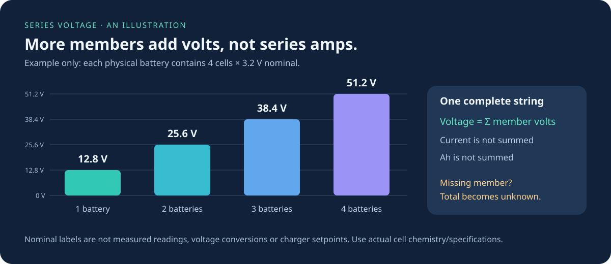

# One virtual battery, several physical batteries

The purpose of each ESP32 monitor is to observe the physical JBD batteries in one
**series string** and expose them as one virtual battery. Every physical battery
retains its own BMS, voltage, current, state of charge and individual cell readings.
The Home Assistant card adds a view of this hierarchy; it does not create the
electrical connection or replace the collector.


Our two maintained installation profiles each monitor four physical batteries,
each containing four cells: 16 cells per virtual battery. The two strings remain
separate virtual batteries. Do not combine their voltages into one series total
unless they actually form a single electrical series string.

## Choose the correct configuration route

- **Existing installation:** keep `jbd-all-batteries1.yaml` and
  `jbd-all-batteries2.yaml`. Their identities, four-by-four inventory, aggregation
  policies and schema-1 telemetry are unchanged.
- **New string with 1, 2, 3 or 4 physical batteries:** generate a separate private
  project using `scripts/generate-series-config.py`. Each member has an explicit
  cell count, from 1 through 32 sensor channels supported by the pinned upstream
  component. A requested sensor count is not proof that a BMS model supports it.
- **More than four physical batteries per ESP32:** not supported by this generator.
  The archived eight-BMS profile is not evidence of a tested general-purpose radio
  topology. Split monitoring among collectors and design the downstream model
  explicitly; a card group does not expand firmware BLE capacity.
- **Parallel or mixed series/parallel banks:** neither this generator nor its
  sums infer wiring. Keep one collector/string model per real series string. Use
  a separately engineered bank integration for parallel current/capacity and
  shared protection behavior.

The current ESP32 board profile remains `esp32dev`/ESP-IDF with minimum silicon
revision 3.1. We do not claim that every ESP32 variant, BMS, cell inventory or BLE
environment has been hardware tested. See [firmware access](firmware-access.md)
before choosing a board or installer.

## Generate a private configuration

Use the Python environment containing ESPHome and PyYAML. Choose a new directory,
unique ESPHome name and MQTT prefix for each collector:

```bash
python scripts/generate-series-config.py \
  --name house-series \
  --topic-prefix house-battery \
  --cells 4,4,4,4 \
  --output "$HOME/.config/jbd-series/house-series"
```

`--cells` lists **cells inside each physical battery**, not the desired nominal
voltage. For one, two or three four-cell physical batteries, use `4`, `4,4` or
`4,4,4`. A single physical 16-cell battery is `16`; this is a different inventory
from `4,4,4,4`, even though both contain 16 cells overall. Unequal counts such as
`4,8` can be represented for observation, but do not establish electrical or
charging compatibility between those physical batteries.

The generator runs on Linux/macOS (POSIX directory-descriptor support). Output
must be inside your home directory or the temporary directory selected by
Python's `tempfile.gettempdir()`, and outside this source checkout. No additional
public temporary-directory aliases are accepted. It refuses existing output
directories, parent traversal (`..`) and symlink components below those roots.
It creates private directories/files through pinned directory descriptors, so a
path replaced by a symlink cannot redirect a write or overwrite an existing file.
It writes `series.yaml`, `components/series_telemetry.h`,
`secrets.example.yaml` and `topology.json`. It does not read private secrets,
connect to the broker, flash hardware or update an existing monitor.

Copy `secrets.example.yaml` to `secrets.yaml` inside the private directory and fill
every placeholder: Wi-Fi, fallback AP password, API encryption key, broker,
broker credentials and each physical BMS MAC. Example MAC addresses are inert
placeholders. Keep this directory private and preserve the header alongside YAML.

```bash
cd "$HOME/.config/jbd-series/house-series"
cp secrets.example.yaml secrets.yaml
# Edit secrets.yaml locally before continuing.
esphome config series.yaml
esphome compile series.yaml
```

Use the compiler version declared in `.release-policy.json`; Linux CI installs
its locked Python 3.12 environment with `scripts/install-esphome.py`. These two
commands validate and compile only. Deployment is a separate step following
[browser installation](browser-install.md) and [firmware access](firmware-access.md).
Custom topologies require their own compiled binary; an existing four-by-four
binary cannot become a one-member collector through a dashboard setting.

## Voltage, current, power, SOC and capacity



The chart assumes four LiFePO4 cells per physical battery at an illustrative
3.2 V nominal per cell. It shows 12.8, 25.6, 38.4 and 51.2 V for one through four
members. Those are labels, not measured values or charger setpoints. Other
chemistries/cell counts require their own manufacturer values. The collector
uses measured volts and does not assume a 12/24/36/48 V class or rescale readings.

Generated profiles apply these explicit policies:

- **Voltage:** sum every configured member voltage only when the complete string
  has valid, fresh required evidence. Missing one member makes the total unknown
  (`NaN`), never a partial sum or extrapolated estimate.
- **Power:** sum `member voltage × member current`, using the same complete round.
  BLE members are polled sequentially, so this is not a simultaneous measurement.
- **Current:** `summed power / summed voltage`, a voltage-weighted estimate from
  BMS readings. Equal current readings return that same current, regardless of
  member count. Unequal readings produce an estimate; they are never added.
  Prefer a properly installed series shunt for authoritative bank current.
- **SOC:** minimum reported member SOC, a conservative display policy. This is
  not a calibrated system SOC or a claim that unequal-capacity members have equal
  usable energy. Zero percent is retained as a valid reading.
- **Capacity:** minimum **remaining Ah** reported by all members. It is not rated
  Ah, and Ah is not summed in series. Missing/expired capacity makes this aggregate
  unknown; a real zero is not discarded as an outlier. This estimate does not
  account for unequal calibration, temperatures or discharge limits.

The original four-by-four profiles retain their historical trimmed SOC mean and
capacity outlier handling for compatibility. The generated profiles intentionally
use the documented minimum-member policies. The Victron bridge has its own
aggregation/protection logic; firmware display sensors do not change its policy.
These monitoring calculations are not charging or protection controls.

## MQTT contracts and Victron boundary

Every generated collector publishes per-BMS MQTT discovery sensors for Home
Assistant and non-retained atomic snapshots at `<topic-prefix>/telemetry`. Each
boot has a new identity and monotonic publication sequence. A reconnect restarts
the round; it cannot republish an old complete snapshot as fresh. Required
evidence is voltage, current, SOC, temperature 1, status/MOS bits and **every
configured cell**. Each callback must belong to the current collection window
and be younger than 60 seconds. Remaining capacity and cycles are optional fields.
Generated profiles also require a fresh reported JBD `cell_count` that exactly
matches the configured member inventory. An accidental four-cell configuration
for a 16-cell BMS therefore cannot produce `ready=true`.

If every member has exactly four cells, generated frames use **schema 1** and the
existing required evidence mask `511`. The current `dbus-mqtt-battery` decoder
accepts a configurable member count, but its deployment must match the generated
inventory: `count`, `bms_first=1`, `cells_per_bms=4`, MQTT prefix, actual chemistry,
cell voltage limits and charger/inverter settings. Existing defaults for four
members must not be reused blindly for one, two or three. Schema compatibility
alone is not commissioning or a guarantee that a particular inverter supports
the new voltage class.

If **any member has a different cell count**, generated frames use **schema 2**.
Cerbo support requires the **dbus-mqtt-battery 2.8.0 beta extension** and an
**explicit topology configuration**. Select and pin a `v2.8.0-beta.*` prerelease
from the [bridge releases](https://github.com/victron-venus/dbus-mqtt-battery/releases).
This is a beta feature. Older releases and the default configuration continue to
use the schema-1 decoder; upgrading the package alone does not enable schema 2.

Home Assistant can continue to use per-BMS MQTT/ESPHome entities for every
generated inventory. The default HA card uses entities; it is not a raw
schema-2 MQTT decoder.

Schema 2 retains boot/sequence/readiness/age fields, adds each member's
`cell_count` and `required_mask`, and sizes its `cells` array to that member.
Generated frames also publish `reported_cell_count`; its fresh equality to
`cell_count` is an additional readiness gate, kept outside the legacy field mask.
Field mask bits 0–3 are voltage/current/SOC/temperature, 4–7 are cells 1–4,
8 is status, 9/10 remain optional capacity/cycles, and 11–38 are cells 5–32.
`seen_mask` and per-member `valid_mask` contain required fields only. The root
`valid_mask` contains one bit per physical member. These masks fit exactly in
JSON's commonly used 53-bit integer precision. Consumers must check the schema
and declared inventory before interpreting masks.

### Commission schema 2 on Cerbo

Follow the bridge's
[explicit-topology guide](https://github.com/victron-venus/dbus-mqtt-battery/blob/9ff889101350f8a148842dfc5091c096f993e95a/docs/flexible-topology.md)
with a pinned 2.8.0 beta build containing the extension. Its examples include a
[single 16-cell battery for offline observation](https://github.com/victron-venus/dbus-mqtt-battery/blob/9ff889101350f8a148842dfc5091c096f993e95a/examples/topology-16s-offline.json),
a [mixed 4/8/4-cell inventory for offline observation](https://github.com/victron-venus/dbus-mqtt-battery/blob/9ff889101350f8a148842dfc5091c096f993e95a/examples/topology-mixed-offline.json),
and a [managed 16-cell example](https://github.com/victron-venus/dbus-mqtt-battery/blob/9ff889101350f8a148842dfc5091c096f993e95a/examples/topology-16s-managed.example.json).

1. Keep the existing four-by-four collectors and Cerbo options unchanged when
   upgrading an established installation. The original configuration path keeps
   its calculations, identities, protections and schema-1 partial-frame grace.
2. Create a separate Cerbo manifest matching the collector's MQTT prefix,
   physical BMS IDs and exact per-member cell counts. The generated ESPHome
   `topology.json` describes the collector; it is **not** the Cerbo manifest, which
   also requires service identities, aggregation choices and protection settings.
3. Run the bridge preflight and begin with `output: offline`. This mode observes
   telemetry without registering another battery service on D-Bus. Confirm fresh
   complete frames, stable cell numbering and the expected series totals.
4. Managed output currently supports equal cell counts per member and an explicit
   complete LiFePO4 protection profile. Supply verified member capacity/current
   ratings and the actual equipment-voltage ceiling. Mixed counts such as
   `[4,8,4]` remain offline-only. The example values are not recommended settings
   for another installation.
5. Commission the selected managed service using the bridge's installation and
   rollback procedure. New topology mode requires complete frames; it does not
   inherit the original decoder's partial-frame grace. A missing required member
   blocks the whole string instead of creating a smaller battery.

New Cerbo topology mode explicitly uses the generated collector's voltage-weighted
current, minimum member SOC and minimum remaining-Ah policies. Existing Cerbo
calculations remain unchanged in the original configuration path. Neither mode
turns a nominal voltage label into a charging setpoint. Multi-collector strings
and generic parallel-bank control are outside this beta extension.

Rollback must restore a compatible driver, producer and configuration together:
an older schema-1-only driver cannot consume a collector that still publishes
schema 2. Do not relabel schema-2 packets as schema 1.

## Home Assistant and card setup

For HA alone, no Cerbo, Venus OS or Victron bridge is required. Follow
[standalone Home Assistant](standalone-home-assistant.md), then configure
[JBD Battery Card](https://github.com/ha-homelab/ha-jbd-bms-card) with one virtual
battery group per real series string and a physical member entry for every BMS.
Use the discovered entity IDs from your HA registry, including each cell's
voltage entity. Entity names can differ after renaming or previous discovery.

Match the card's member/cell inventory to `topology.json`; card configuration does
not change the BLE collector. Nominal voltage and display voltage ranges are
presentation settings, not unit conversion, charging setpoints or substitutes
for missing readings. MQTT sensors can keep their last value after a missed BLE
reply, so an available HA entity is not by itself proof of a complete fresh
collector round. Consult the atomic telemetry for commissioning/freshness.

## Commissioning and recovery runbook

1. Record the actual wiring, member order, per-member cells, BMS MACs, chemistry
   and intended series voltage. Back up the current private configuration and
   known-good firmware before replacing a collector.
2. Generate into a new private directory with a new MQTT identity. Compare
   `topology.json`, YAML inventory and secrets against the physical labels.
3. Run source tests, `esphome config` and `esphome compile`. Bench-test the actual
   board and BMS combination before using the results in a power-control path.
4. After the separately authorized firmware installation, inspect all physical
   pack voltages, currents and cells. Confirm member IDs start at 1, the expected
   schema and member count, advancing `seq`, and `ready=true` only after a full
   round. Independently compare the total voltage with the real string.
5. Test one missing BLE member, a collector reboot and a broker outage in a safe
   commissioning setup. Check that no partial total is presented as complete,
   and that recovery requires a fresh round. Verify HA freshness separately from
   cached scalar state. Observe real polling latency and RF stability.
6. Add the card groups and voltage labels after the telemetry checks. If a Victron
   consumer is used, validate its matching configuration and protection behavior
   separately before allowing it to influence charging.
7. To roll back, restore the backed-up private firmware/configuration and its
   matching consumer/card inventory. Do not run two publishers on one MQTT
   prefix. Retire old discovery entries only after identifying which are stale.

## Troubleshooting

- **Total becomes unknown:** inspect `ready`, root member mask and each member's
  `seen_mask`/`valid_mask`/age. A fresh pack voltage alone does not complete a round.
  Check all configured cells, temperature and status callbacks. Do not remove
  the missing member from the inventory to hide a real series fault.
- **Extra cells never appear:** check the physical BMS cell inventory and selected
  protocol/model. Configuring 16 sensors does not create 16 actual cell readings.
  Missing required cell callbacks correctly keep the round incomplete.
  Compare `cell_count` and `reported_cell_count`; a mismatch or missing reported
  count also prevents readiness, even when every configured cell has a value.
- **Only one BMS connects:** check unique MACs, BLE range and competing phone/BMS
  app connections. Validate the board revision and connection settings. A
  successful software build does not prove RF reliability.
- **Wrong 12/24/36/48 V label:** configure the card's nominal/display range using
  the real cell count/chemistry. Do not multiply a measured member voltage to
  manufacture a whole-string reading.
- **Current differs among members:** compare calibration, load transients and
  sequential polling times. The weighted estimator can hide disagreement;
  inspect individual readings and use a shunt when precision is required.
- **Capacity seems too small:** this is remaining Ah of the lowest member, not
  summed Ah or rated capacity. Check BMS calibration and whether zero is real.
- **Victron rejects telemetry:** verify the installed bridge build, selected
  configuration mode, MQTT prefix and exact member inventory. Schema 2 requires
  the 2.8.0 beta extension and explicit topology mode; older/default schema-1
  configurations remain incompatible. Check both `cell_count` and
  `reported_cell_count`. Do not change the schema number to 1 as a workaround.
- **Entities duplicate or rename:** ensure unique ESPHome names, MQTT prefixes
  and MAC-based discovery for new collectors. Keep legacy Chain 1 identity intact.
- **HA is available but measurements are old:** network availability and per-BMS
  freshness are different. Inspect the live atomic frame and callback ages; the
  card cannot recover data the collector did not observe.

## Validation boundaries and primary references

`tests/test_series_config.py` executes the C++ collector with address/undefined
behavior sanitizers for one through four members, 1/4/16/32-cell and mixed cell
inventories. It checks missing/invalid evidence, stale totals, zero SOC/Ah,
current/capacity policies, rollover, reconnect sessions and generated YAML
inventory. These tests do not exercise BLE hardware or prove a safe electrical
configuration. Each generated project still needs ESPHome validation and compile;
the existing profile compile jobs remain in place. CI additionally validates
nine generated inventories and compiles the maximum four-member/32-cells-each example. Run
`python scripts/check-generated-series.py --compile` in the pinned ESPHome
environment to reproduce that check using isolated temporary dummy credentials.

- [Pinned JBD cell sensor inventory (1–32)](https://github.com/syssi/esphome-jbd-bms/blob/70831773385cfa803a543d87f4ca9e65a2f8415a/components/jbd_bms_ble/sensor.py)
- [ESPHome BLE client documentation](https://esphome.io/components/ble_client/)
- [Existing schema-1 contract](battery-telemetry.md)
- [Victron MQTT battery bridge](https://github.com/victron-venus/dbus-mqtt-battery)
- [Home Assistant card, configuration and screenshots](https://github.com/ha-homelab/ha-jbd-bms-card)
